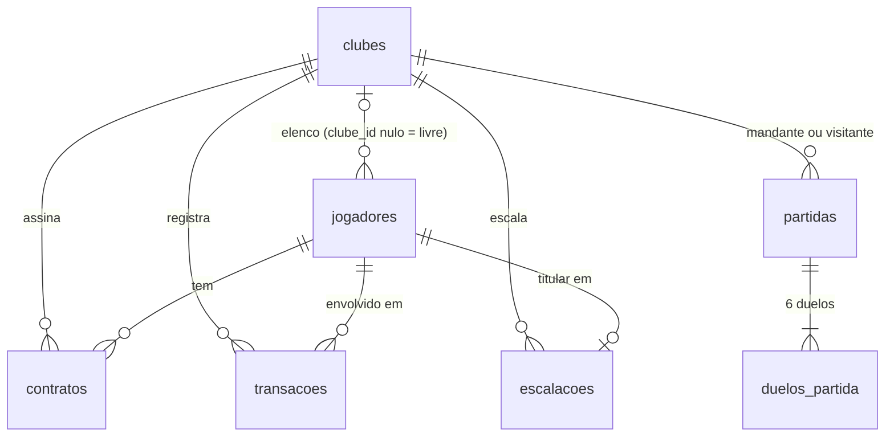

# Banco de dados — LigaHub (backend)

PostgreSQL 16. Esquema criado **somente por migrations Flyway** (`src/main/resources/db/migration`), com
`spring.jpa.hibernate.ddl-auto=validate`. O banco criado começa **vazio** (sem jogadores, clubes, transações nem
partidas); dados de exemplo, se houver, só por comando separado e opcional.

## Regras obrigatórias (barema B3)

- **7 tabelas obrigatórias**, nomes em português, sem acento, snake_case: `jogadores`, `clubes`, `contratos`,
  `transacoes`, `escalacoes`, `partidas`, `duelos_partida`. Colunas/tabelas/índices adicionais são permitidos.
- Todas as colunas abaixo são obrigatórias com esses nomes. Cada tabela, coluna, PK ou FK ausente ou com outro
  nome conta como desvio.
- **Moeda** em `DECIMAL`/`NUMERIC` (ou inteiro em centavos) — o único tipo conferido. Nas demais colunas o tipo
  é referência (ex.: `condicao` pode ser enum, desde que a API use os valores do enunciado — issue #3).
- **Ids inteiros** (autoincremento: `GENERATED BY DEFAULT AS IDENTITY`). UUID não é aceito.
- **Unicidades obrigatórias no banco:**
  1. nome do clube conforme RN10: ignora maiúsculas/minúsculas, **considera acentos** →
     `CREATE UNIQUE INDEX ux_clubes_nome ON clubes (lower(nome));`
     (o banco deve usar encoding UTF-8 para `lower` tratar letras acentuadas; "Águias FC" e "águias fc"
     colidem; "Águias FC" e "Aguias FC" não). A banca testa com **inserções diretas no banco**, então a
     garantia tem de estar no banco, não só na aplicação;
  2. `clubes.sigla` UNIQUE;
  3. `escalacoes.jogador_id` UNIQUE (um jogador em no máximo uma escalação).
- **Proibido gravar valores calculados**: valor de mercado atual, overall, valor do elenco, patrimônio, dias
  restantes, percentual de multa, pontos e posição na classificação **não podem ser colunas**. Os valores do
  momento em `contratos.valor_compra` e `transacoes.valor` são obrigatórios.
- CHECK de limites não é obrigatório (validação na API atende — issue #3).

## Diagrama

## Tabelas

### `jogadores`

| Coluna | Tipo | Descrição |
| --- | --- | --- |
| `id` | INTEGER | PK |
| `nome` | VARCHAR(100) | Nome |
| `posicao` | VARCHAR(3) | GOL, ZAG, LAT, MEI, ATA |
| `agilidade` | INTEGER | 1–100 |
| `idade` | INTEGER | 16–45 |
| `valor_base` | DECIMAL(6,2) | Calculado no cadastro (RN06); não muda |
| `condicao` | VARCHAR(20) | APTO, MAL_CONDICIONADO, DOENTE |
| `clube_id` | INTEGER | FK `clubes.id`; nulo se livre |
| `velocidade`, `finalizacao`, `passe`, `drible`, `defesa`, `fisico` | INTEGER | Atributos 1–99 |
| `potencial` | INTEGER | 1–99 |
| `excluido_em` | TIMESTAMP | Exclusão lógica (RN09); nulo se ativo |
| `criado_em` / `atualizado_em` | TIMESTAMP | Criação / última alteração |

Mapeamento API ↔ banco dos atributos: `pace`↔`velocidade`, `shooting`↔`finalizacao`, `passing`↔`passe`,
`dribbling`↔`drible`, `defending`↔`defesa`, `physical`↔`fisico`, `potential`↔`potencial`.

### `clubes`

| Coluna | Tipo | Descrição |
| --- | --- | --- |
| `id` | INTEGER | PK |
| `nome` | VARCHAR(60) | Único conforme RN10 (índice em `lower(nome)`) |
| `sigla` | CHAR(3) | UNIQUE |
| `caixa` | DECIMAL(10,2) | Padrão 300.00 |
| `formacao` | VARCHAR(5) | `3-1`, `2-2`, `2-1-1`, `1-2-1`; nula enquanto não escalou |
| `criado_em` | TIMESTAMP | Criação |

### `contratos`

| Coluna | Tipo | Descrição |
| --- | --- | --- |
| `id` | INTEGER | PK |
| `jogador_id` / `clube_id` | INTEGER | FKs `jogadores.id`, `clubes.id` |
| `valor_compra` | DECIMAL(6,2) | Valor de mercado pago (sem a taxa) |
| `fidelidade_ate` | TIMESTAMP | Fim da fidelidade |
| `situacao` | VARCHAR(12) | ATIVO, ENCERRADO, RESCINDIDO |
| `iniciado_em` / `encerrado_em` | TIMESTAMP | Compra / venda (nulo enquanto ATIVO) |

### `transacoes`

| Coluna | Tipo | Descrição |
| --- | --- | --- |
| `id` | INTEGER | PK |
| `clube_id` / `jogador_id` | INTEGER | FKs |
| `nome_jogador` | VARCHAR(100) | Nome no momento |
| `tipo` | VARCHAR(6) | COMPRA, VENDA |
| `valor` | DECIMAL(6,2) | Valor de mercado no momento |
| `taxa` | DECIMAL(6,2) | Taxa de compra ou comissão |
| `multa` | DECIMAL(6,2) | 0,00 na compra |
| `lucro` | DECIMAL(7,2) | Nulo na compra |
| `variacao_caixa` | DECIMAL(8,2) | Com sinal |
| `criado_em` | TIMESTAMP | Momento da operação |

### `escalacoes`

| Coluna | Tipo | Descrição |
| --- | --- | --- |
| `clube_id` | INTEGER | FK `clubes.id` |
| `jogador_id` | INTEGER | FK `jogadores.id`, **UNIQUE** |
| `criado_em` | TIMESTAMP | Quando foi escalado |

**PK composta (`clube_id`, `jogador_id`)** — PK em outras colunas conta como desvio. Em JPA: `@EmbeddedId` ou
`@IdClass`.

### `partidas`

| Coluna | Tipo | Descrição |
| --- | --- | --- |
| `id` | INTEGER | PK |
| `mandante_id` / `visitante_id` | INTEGER | FKs `clubes.id` |
| `gols_mandante` / `gols_visitante` | INTEGER | 0–3 |
| `formacao_mandante` / `formacao_visitante` | VARCHAR(5) | Formações no momento |
| `jogada_em` | TIMESTAMP | Data/hora da partida |

### `duelos_partida`

| Coluna | Tipo | Descrição |
| --- | --- | --- |
| `id` | INTEGER | PK |
| `partida_id` | INTEGER | FK `partidas.id` |
| `ordem` | INTEGER | 1–6 |
| `clube_atacante_id` | INTEGER | FK `clubes.id` |
| `atacante_id` / `defensor_id` | INTEGER | FKs `jogadores.id` |
| `nome_atacante` / `nome_defensor` | VARCHAR(100) | Nomes no momento |
| `posicao_atacante` / `posicao_defensor` | VARCHAR(3) | Posições no momento |
| `condicao_atacante` / `condicao_defensor` | VARCHAR(20) | APTO ou MAL_CONDICIONADO |
| `atributo_ataque` / `atributo_defesa` | VARCHAR(10) | `shooting`, `passing`, `dribbling`, `defending` |
| `valor_ataque` / `valor_defesa` | INTEGER | Já com efeito da condição |
| `gol` | BOOLEAN | Se virou gol |

## Timestamps

Decisão: colunas `TIMESTAMPTZ` (o tipo é só referência no barema) e `Instant` em Java; a conversão para
`-03:00` acontece só na borda (DTOs). Registrar no README em "Decisões e premissas".

## Migrations

- `V1__create_schema.sql`: as 7 tabelas, PKs, FKs, `uk_clubes_sigla`, `ux_clubes_nome` (`lower(nome)`),
  `pk_escalacoes` composta e `uk_escalacoes_jogador`.
- Migration aplicada nunca é editada: mudança de esquema = nova migration `V<n>__<descricao>.sql`.

## Criação e recriação

- Criar: subir o PostgreSQL (`docker compose up -d db`) e iniciar a aplicação — o Flyway aplica as migrations.
- Recriar do zero: `docker compose down -v` (remove o volume) seguido de subir de novo; ou
  `./mvnw flyway:clean flyway:migrate` com `cleanDisabled=false` apenas em dev. Documentar no README os comandos
  exatos, copiáveis, no Ubuntu 24.04.
